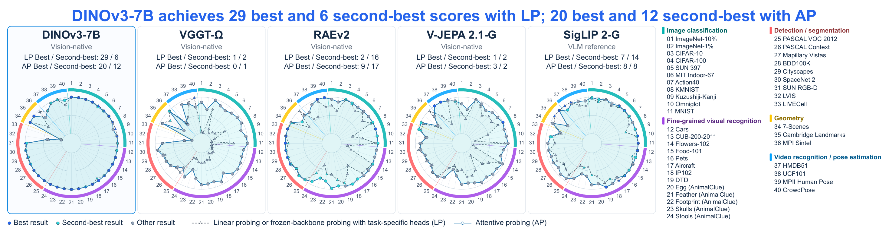

<h1 align="center">Revisiting Vision Model Baselines in the Deep Learning Era</h1>

<p align="center">
  <a href="https://hirokatsukataoka.net/">Hirokatsu Kataoka</a> ·
  <a href="https://kohsukeide.github.io/">Kohsuke Ide</a> ·
  <a href="https://github.com/gatheluck">Yoshihiro Fukuhara</a> ·
  <a href="https://shumpei-takezaki.github.io/">Shumpei Takezaki</a> ·
  <a href="https://researchmap.jp/nakamasa_inoue">Nakamasa Inoue</a> ·
  <a href="https://yukimasano.github.io/">Yuki M Asano</a> ·
  <a href="https://www.cs.ox.ac.uk/people/christian.rupprecht/">Christian Rupprecht</a>
</p>

<p align="center">
  <strong>Paper</strong> (arXiv forthcoming) ·
  <a href="https://gatheluck.github.io/10YearVisualSSL/">Project Page</a> ·
  <a href="https://gatheluck.github.io/10YearVisualSSL/leaderboard.html#leaderboard">Interactive rankings</a> ·
  <a href="#citation">Citation</a> ·
  <a href="https://github.com/gatheluck/10YearVisualSSL/actions/workflows/tests.yml?query=branch%3Amain">Tests on main</a>
</p>

<p align="center">
  <a href="#highlights">Highlights</a> ·
  <a href="#model-rankings">Model rankings</a> ·
  <a href="#quick-start">Quick start</a> ·
  <a href="#results">Results</a> ·
  <a href="#repository-guide">Repository guide</a>
</p>

<p align="center">
  <a href="docs/figures/extended-transfer.png"></a>
</p>

[Open the full-resolution figure](docs/figures/extended-transfer.png). Across 40 extended evaluation settings, DINOv3-7B ranks first on 29 with LP and 20 with AP among the five models. Radial lengths compare models within the same setting and probing method. [Evaluation settings and metrics](docs/CVPR_EXTENDED_COVERAGE.md)

<a name="key-results"></a>

## Highlights

- **Rankings vary by task.** RAEv2 ranks first on ADE20K segmentation and 100th on SSv2 video recognition in the 109-model comparison.
- **Probing methods can give different rankings.** Among five models on SSv2, linear and attentive probing give different orders for 4 of 10 model pairs. [Readout comparison](docs/PAPER_REPRODUCTION_GUIDE.md#figure-3--unified-readout-and-adaptation).
- **Patch similarity improves predictions on two tasks.** Adding patch-level agreement to image-level agreement raises Spearman rank correlation on held-out model families from 0.19 to 0.75 on ADE20K and from 0.01 to 0.67 on NYUv2. [Prediction analysis](docs/PAPER_REPRODUCTION_GUIDE.md#figure-7--representation-geometry).

## Model rankings

30 of 109 models are shown below, through overall rank 30. Overall rank comes from averaging the five task ranks. Rank 1 is best.

SSv2 is Something-Something v2. On narrow screens, scroll within the table to see all five tasks.

| Overall | Model | ImageNet-1K | COCO | ADE20K | NYUv2 | SSv2 |
| ---: | --- | ---: | ---: | ---: | ---: | ---: |
| 1 | DINOv3-7B | 1 | 1 | 9 | 17 | 3 |
| 2 | DINOv2 | 14 | 11 | 5 | 5 | 8 |
| 3 | ConvNeXt-L | 4 | 13 | 22 | 25 | 11 |
| 4 | Franca | 20 | 33 | 7 | 12 | 23 |
| 5 | ConvNeXt V2 | 10 | 22 | 17 | 26 | 24 |
| 6 | MambaVision | 12 | 27 | 19 | 37 | 15 |
| 7 | RAEv2 | 2 | 5 | 1 | 8 | 100 |
| 8 | V-JEPA 2.1 | 54 | 4 | 24 | 33 | 2 |
| 9 | SigLIP 2-G | 3 | 3 | 4 | 108 | 4 |
| 9 | Swin-B | 9 | 25 | 18 | 43 | 27 |
| 11 | SwinV2-B | 8 | 34 | 21 | 36 | 26 |
| 12 | ConvNeXt | 15 | 39 | 33 | 30 | 11 |
| 13 | ViT-L/16 | 31 | 9 | 41 | 32 | 18 |
| 14 | RAE | 7 | 7 | 2 | 20 | 103 |
| 15 | SwAV | 46 | 16 | 37 | 31 | 17 |
| 16 | RAVLT-S | 5 | 54 | 27 | 49 | 16 |
| 17 | ViT-B/16 | 23 | 20 | 49 | 28 | 32 |
| 18 | ResNet-50 | 24 | 14 | 58 | 48 | 10 |
| 19 | Swin V2 | 17 | 36 | 32 | 41 | 29 |
| 20 | Swin | 21 | 24 | 29 | 51 | 31 |
| 21 | I-JEPA | 56 | 49 | 15 | 23 | 14 |
| 22 | InternVideo2 | 32 | 28 | 3 | 16 | 83 |
| 22 | AIM | 28 | 31 | 13 | 9 | 81 |
| 22 | ResNet-152 | 40 | 6 | 43 | 54 | 19 |
| 25 | BYOL | 44 | 15 | 47 | 52 | 7 |
| 26 | Barlow Twins | 60 | 8 | 54 | 45 | 9 |
| 27 | MAE | 53 | 38 | 10 | 10 | 67 |
| 28 | CaiT | 16 | 97 | 11 | 22 | 38 |
| 29 | PVT | 34 | 46 | 28 | 40 | 40 |
| 30 | CLIP | 27 | 40 | 8 | 109 | 5 |

[All 109 models and their exact ranks](docs/BASIC_FIVE_RANKS.md) · [Interactive rankings](https://gatheluck.github.io/10YearVisualSSL/leaderboard.html#leaderboard)

## Comparison settings

- **Original settings (ASIS).** Evaluate released or reproduced models using protocols specific to each family.
- **Controlled pre-training (CTRL).** Train 32 self-supervised methods under shared pre-training conditions.
- **Unified evaluation.** Compare selected models on the same downstream tasks, data splits and metrics, using model-specific features.

[Study settings and terminology](docs/PAPER_TERMINOLOGY.md)

<a name="quick-verification"></a>

## Quick start

From the repository root, run this command with Python 3.12 to generate sample LoRA training files. It uses the Python standard library and requires a new output directory.

```sh
python3 -m downstream.figure3_lora_configs --paths configs/figure3-lora-paths.example.json --out figure3-configs
```

The command writes **45 JSON files** in `figure3-configs/` for three tasks, five encoders and three random seeds. Open one to inspect the dataset path, encoder and seed. For training, supply real paths and follow the [LoRA run instructions](docs/LORA_FULL_REPRODUCTION.md). To exercise the evaluators on local fixtures, follow the [environment setup and smoke tests](OPERATING_GUIDE.md#quick-verification).

## Results

For each model, compare linear probing (LP) and LoRA on the same five tasks. LP trains a task head on a frozen backbone. LoRA trains rank-16 attention adapters and the task head while keeping the original backbone weights fixed.

Each cell shows mean ± standard deviation over three runs. ↑ Higher is better. ↓ Lower is better. ImageNet-1K and SSv2 report top-1 accuracy (%), COCO reports bounding-box mean average precision (0–100), ADE20K reports mean intersection over union (%), and NYUv2 reports root mean squared depth error (m). On narrow screens, scroll within the table to see all five tasks.

| Model | Method | ImageNet-1K ↑ | COCO ↑ | ADE20K ↑ | NYUv2 ↓ | SSv2 ↑ |
| --- | --- | ---: | ---: | ---: | ---: | ---: |
| DINOv3-7B | LP | 86.54<br><sub>±0.01</sub> | 40.77<br><sub>±0.04</sub> | 47.14<br><sub>±0.07</sub> | 0.577<br><sub>±0.001</sub> | 14.90<br><sub>±0.23</sub> |
| DINOv3-7B | LoRA | 87.90<sup>†</sup><br><sub>±0.03</sub> | 52.63<br><sub>±0.04</sub> | 51.67<br><sub>±0.16</sub> | 0.396<br><sub>±0.002</sub> | 56.12<sup>†</sup><br><sub>±0.11</sub> |
| VGGT-Ω | LP | 10.68<br><sub>±0.02</sub> | 10.54<br><sub>±0.09</sub> | 30.48<br><sub>±0.25</sub> | 0.678<br><sub>±0.009</sub> | 4.70<br><sub>±0.02</sub> |
| VGGT-Ω | LoRA | 85.49<br><sub>±0.05</sub> | 42.61<br><sub>±0.16</sub> | 44.46<br><sub>±0.24</sub> | 0.418<br><sub>±0.003</sub> | 68.12<br><sub>±0.10</sub> |
| RAEv2 | LP | 75.41<br><sub>±0.01</sub> | 38.91<br><sub>±0.12</sub> | 43.04<br><sub>±0.09</sub> | 0.662<br><sub>±0.039</sub> | 8.20<br><sub>±0.37</sub> |
| RAEv2 | LoRA | 87.34<br><sub>±0.01</sub> | 47.37<br><sub>±0.11</sub> | 46.70<br><sub>±0.22</sub> | 0.472<br><sub>±0.002</sub> | 48.70<br><sub>±0.15</sub> |
| V-JEPA 2.1-G | LP | 57.61<br><sub>±0.03</sub> | 35.39<br><sub>±0.35</sub> | 36.10<br><sub>±0.12</sub> | 0.776<br><sub>±0.029</sub> | 21.51<br><sub>±0.22</sub> |
| V-JEPA 2.1-G | LoRA | 83.88<br><sub>±0.03</sub> | 46.82<br><sub>±0.04</sub> | 44.99<br><sub>±0.13</sub> | 0.461<br><sub>±0.003</sub> | 75.72<br><sub>±0.20</sub> |
| SigLIP 2-G | LP | 84.61<br><sub>±0.01</sub> | 35.51<br><sub>±0.06</sub> | 37.21<br><sub>±0.08</sub> | 0.848<br><sub>±0.007</sub> | 22.96<br><sub>±1.06</sub> |
| SigLIP 2-G | LoRA | 87.31<br><sub>±0.10</sub> | 49.70<br><sub>±0.09</sub> | 49.08<br><sub>±0.23</sub> | 0.479<br><sub>±0.005</sub> | 48.92<br><sub>±0.29</sub> |

† DINOv3-7B LoRA used 50 epochs on ImageNet-1K and 24 on SSv2. Other models used 100 and 50 epochs, respectively.

<details>
<summary>Sources and run notes</summary>

The 50 scores come from Figure 3 and Supplement Tables 22 and 25. Figure 3 labels COCO LP “Head-only.” NYUv2 LoRA reports depth error without aligning predictions to reference depths.

The audit found only aggregate support for VGGT-Ω COCO LP. For RAEv2 LP, the paper describes generator features and the audited runs used a seven-layer tokenizer. See the [full Figure 3 reproduction guide](docs/PAPER_REPRODUCTION_GUIDE.md#figure-3--unified-readout-and-adaptation) and [run attribution and metric notes](docs/BASIC5_V1_AUDIT.md).

</details>

<a name="methods"></a>

<a name="reproduction-scope"></a>

## Repository guide

| I want to… | Start here |
| --- | --- |
| Check that the tools run | [Quick start](#quick-start) and [local smoke tests](OPERATING_GUIDE.md#quick-verification) |
| Find a model implementation | [Method index](OPERATING_GUIDE.md#methods) |
| Train a model | [Prepare training settings](OPERATING_GUIDE.md#reproducibility-the-resolved-config) and [run training](OPERATING_GUIDE.md#training-a-method) |
| Run a downstream evaluation | [Task guide](docs/DOWNSTREAM.md) and [output checks](OPERATING_GUIDE.md#checking-an-adapters-output-against-the-contract) |
| Reproduce a reported result | [Reproduction guide](docs/PAPER_REPRODUCTION_GUIDE.md), [package scope](docs/SUBMISSION_SCOPE.md) and [study terminology](docs/PAPER_TERMINOLOGY.md) |
| Run an extended evaluation | [Image classification](docs/EXTENDED_CLASSIFICATION.md), [semantic segmentation](docs/EXTENDED_SEGMENTATION.md) or [video](docs/EXTENDED_VIDEO.md) |

<a name="find-a-figure-or-table"></a>

<details>
<summary>Figure and table index</summary>

Open the [interactive rankings](https://gatheluck.github.io/10YearVisualSSL/leaderboard.html#leaderboard) or use the figure index to find input data, code and verification results.

| Figure | Question and companion tables | Instructions | Code or protocol |
| --- | --- | --- | --- |
| Figure 1 | How do 109 models rank across five tasks? | [Five-task ranks](docs/PAPER_REPRODUCTION_GUIDE.md#figure-1--five-task-ranks) | [Original self-supervised evaluation protocols](docs/initial_protocols/INITIAL_STEP1_v1.md) |
| Figure 2 | How do scores vary across 113 checkpoint and evaluation setups? Tables 10, 12–18 | [ASIS scores and procedures](docs/PAPER_REPRODUCTION_GUIDE.md#figure-2--historical-transfer) | [Native detection](downstream/native_detection.py) |
| Figure 3 | How do frozen-model probes and LoRA compare? Tables 22–26 | [Unified readout and adaptation](docs/PAPER_REPRODUCTION_GUIDE.md#figure-3--unified-readout-and-adaptation) | [LoRA training settings](downstream/figure3_lora_configs.py) |
| Figure 4 | How do scores differ between the original settings (ASIS) and controlled pre-training (CTRL)? Tables 19–21 | [Controlled pre-training](docs/PAPER_REPRODUCTION_GUIDE.md#figure-4--controlled-pre-training) | [Paired comparison](downstream/controlled_comparison.py) |
| Figure 5 | How do models perform across 40 downstream evaluation settings? Tables 27–28 | [Extended transfer](docs/PAPER_REPRODUCTION_GUIDE.md#figure-5--extended-transfer) | [Transfer comparison](downstream/transfer_comparison.py) |
| Figure 6 | How do frontier systems perform on the same test examples? Table 29 | [Frontier matched subsets](docs/PAPER_REPRODUCTION_GUIDE.md#figure-6--frontier-matched-subsets) | [Prediction scorer](downstream/frontier.py) |
| Figure 7 | How well does similarity between model features predict task rankings? Tables 31–32 | [Representation geometry](docs/PAPER_REPRODUCTION_GUIDE.md#figure-7--representation-geometry) | [Nested analysis](downstream/representation_nested.py) |

Figure 2 counts each combination of model checkpoint, the features used and the evaluation protocol as one setup. Its plotted set includes DINOv3 ViT-B/16, MAGE, JiT and Wan2.2, which are outside Figure 1’s ranking. Wan2.2 has no reported ADE20K score.

For Table 30 (model scaling) and the supplement's separately numbered figures, use the [supplement reading order](docs/PAPER_REPRODUCTION_GUIDE.md#supplement-reading-order).

</details>

<a name="evaluation-protocols"></a>

<details>
<summary>Evaluation protocols</summary>

These are the main evaluation protocols for the five tasks. Linear probing, attentive probing and full fine-tuning use version 1. The LoRA and DPT version 2 documents describe the settings used in the recorded runs. The planned random seeds were 0, 1 and 2. See [COCO metrics and completed FT repeats](docs/BASIC5_V1_AUDIT.md#coco-evaluation-and-completed-repeats) for the reported populations and final-epoch results. In Table 26, 18 of 25 full fine-tuning entries have three runs, VGGT-Omega on SSv2 has one run, and six entries are blank.

| Method | Protocol | Training and evaluation details |
| --- | --- | --- |
| Linear probing (LP) | [Markdown](docs/current_protocols/BASIC5_LINEAR_v1.md) · [JSON](docs/current_protocols/BASIC5_LINEAR_v1.json) | Frozen encoder with a trained task-specific head, including Faster R-CNN for COCO object detection. See the [optimization and evaluation audit](docs/BASIC5_V1_AUDIT.md#what-was-compared). |
| Attentive probing (AP) | [Markdown](docs/current_protocols/BASIC5_ATTENTIVE_v1.md) · [JSON](docs/current_protocols/BASIC5_ATTENTIVE_v1.json) | For SSv2 in Figure 3, see the [attention module and input features used for each model](docs/SSV2_EXECUTION.md#figure-3-attentive-probes). |
| Full fine-tuning (FT) | [Markdown](docs/current_protocols/BASIC5_FINETUNE_v1.md) · [JSON](docs/current_protocols/BASIC5_FINETUNE_v1.json) | End-to-end training. The [execution audit](docs/BASIC5_V1_AUDIT.md#what-was-compared) documents differences between the protocol and the runs, including ImageNet label smoothing. |
| LoRA | [Markdown](docs/current_protocols/BASIC5_LORA_v2.md) · [JSON](docs/current_protocols/BASIC5_LORA_v2.json) | [Task-specific schedules](docs/CVPR_ADAPTATION.md#revised-image-and-semantic-task-cli) and [DINOv3 shorter runs](docs/CVPR_ADAPTATION.md#author-supplied-november-v2-run-descriptions). |
| DPT dense probing | [Markdown](docs/current_protocols/BASIC5_DPT_v2.md) · [JSON](docs/current_protocols/BASIC5_DPT_v2.json) | [Decoder using features from four layers](docs/CVPR_ADAPTATION.md#training-facing-checks-and-four-tap-dense-probe) for ADE20K and NYUv2. On NYUv2 the paper measures depth error without aligning predictions to reference depths. |

For the 40 Extended transfer settings, see the [datasets and metrics used in Figure 5](docs/CVPR_EXTENDED_COVERAGE.md). The list gives the segmentation metrics used for SpaceNet 2 and SUN RGB-D.

</details>

<a name="files-cited-in-appendix-e"></a>

<details>
<summary>Appendix protocol files</summary>

Open the protocol files cited in Supplement Appendix E. The table above links the versions and model settings used for the five tasks.

| Appendix section | Companion files |
| --- | --- |
| E.2 · Initial comparisons | [INITIAL_STEP1_v1.md](docs/initial_protocols/INITIAL_STEP1_v1.md) · [INITIAL_STEP2_v1.md](docs/initial_protocols/INITIAL_STEP2_v1.md) |
| E.3 · Initial comparisons by family | [INITIAL_STEP3_3DFM_v1.md](docs/initial_protocols/INITIAL_STEP3_3DFM_v1.md) · [INITIAL_STEP3_4DFM_v1.md](docs/initial_protocols/INITIAL_STEP3_4DFM_v1.md) · [INITIAL_STEP3_VISION_GENERATIVE_v1.md](docs/initial_protocols/INITIAL_STEP3_VISION_GENERATIVE_v1.md) · [INITIAL_STEP3_VIDEO_SSL_v1.md](docs/initial_protocols/INITIAL_STEP3_VIDEO_SSL_v1.md) · [INITIAL_STEP3_VIDEO_WORLD_MODELS_v1.md](docs/initial_protocols/INITIAL_STEP3_VIDEO_WORLD_MODELS_v1.md) · [INITIAL_STEP3_VLM_v1.md](docs/initial_protocols/INITIAL_STEP3_VLM_v1.md) |
| E.4 · Basic Five baseline filenames | [BASIC5_LINEAR.md](docs/submission_protocols/BASIC5_LINEAR.md) · [BASIC5_ATTENTIVE.md](docs/submission_protocols/BASIC5_ATTENTIVE.md) · [BASIC5_FINETUNE.md](docs/submission_protocols/BASIC5_FINETUNE.md) |
| E.4 · LoRA and DPT | [BASIC5_LORA_v2.md](docs/current_protocols/BASIC5_LORA_v2.md) · [BASIC5_LORA_v2.json](docs/current_protocols/BASIC5_LORA_v2.json) · [BASIC5_DPT_v2.md](docs/current_protocols/BASIC5_DPT_v2.md) · [BASIC5_DPT_v2.json](docs/current_protocols/BASIC5_DPT_v2.json) |
| E.5 · Extended LP | [EXTEND_LINEAR.md](docs/submission_protocols/EXTEND_LINEAR.md) · [EXTEND_LINEAR_v1.json](docs/submission_protocols/EXTEND_LINEAR_v1.json) |
| E.5 · Extended AP | [EXTEND_ATTENTIVE.md](docs/submission_protocols/EXTEND_ATTENTIVE.md) · [EXTEND_ATTENTIVE_v1.json](docs/submission_protocols/EXTEND_ATTENTIVE_v1.json) |
| E.5 · Extended FT | [EXTEND_FINETUNE.md](docs/submission_protocols/EXTEND_FINETUNE.md) · [EXTEND_FINETUNE_v1.json](docs/submission_protocols/EXTEND_FINETUNE_v1.json) |
| E.6 · Frontier-system prompts | [BASIC5_FRONTIER_SYSTEM_PROMPTS.md](docs/submission_protocols/BASIC5_FRONTIER_SYSTEM_PROMPTS.md) |

</details>

## License

- **Repository contributions.** The authors provide their contributions under the [MIT License](LICENSE).
- **Upstream implementations and checkpoints.** Each upstream implementation and checkpoint carries its own license and redistribution terms. See the [third-party license inventory](docs/THIRD_PARTY_LICENSES.md) for the specific artifacts and notices.
- **Datasets.** Obtain datasets from their original distributors and follow the terms for each dataset.

## Citation

Hirokatsu Kataoka, Kohsuke Ide, Yoshihiro Fukuhara, Shumpei Takezaki, Nakamasa Inoue, Yuki M Asano and Christian Rupprecht. *Revisiting Vision Model Baselines in the Deep Learning Era*. Manuscript, 2026. [BibTeX](https://gatheluck.github.io/10YearVisualSSL/#citation)

```bibtex
@unpublished{kataoka2026revisiting,
  title  = {Revisiting Vision Model Baselines in the Deep Learning Era},
  author = {Hirokatsu Kataoka and Kohsuke Ide and Yoshihiro Fukuhara and
            Shumpei Takezaki and Nakamasa Inoue and Yuki M Asano and
            Christian Rupprecht},
  year   = {2026},
  note   = {Manuscript}
}
```
