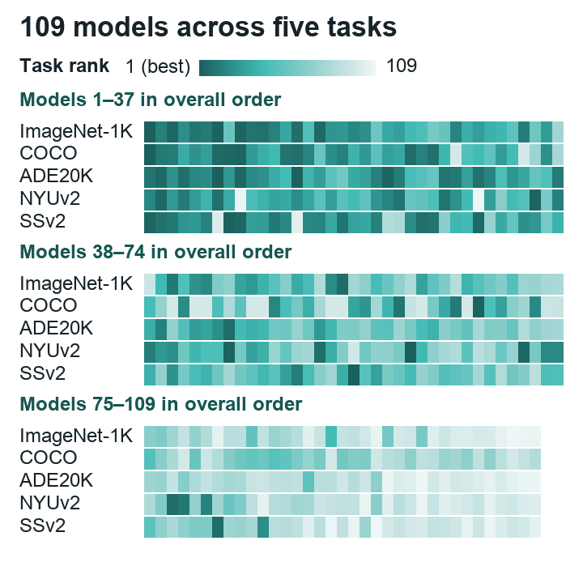

# Task ranks for 109 models

The overall rank follows the average of the five task ranks. Ties retain their published rank. Rows follow the order used in the paper’s ranking plot.

[Back to the README](../README.md) · [Ranking source and checks](PAPER_REPRODUCTION_GUIDE.md#figure-1--five-task-ranks) · [Package scope](SUBMISSION_SCOPE.md) · [Interactive rankings](https://gatheluck.github.io/10YearVisualSSL/leaderboard.html#leaderboard)

Heatmap for all 109 models

| Model | Overall | ImageNet-1K | COCO | ADE20K | NYUv2 | SSv2 |
| --- | ---: | ---: | ---: | ---: | ---: | ---: |
| DINOv3-7B | 1 | 1 | 1 | 9 | 17 | 3 |
| DINOv2 | 2 | 14 | 11 | 5 | 5 | 8 |
| ConvNeXt-L | 3 | 4 | 13 | 22 | 25 | 11 |
| Franca | 4 | 20 | 33 | 7 | 12 | 23 |
| ConvNeXt V2 | 5 | 10 | 22 | 17 | 26 | 24 |
| MambaVision | 6 | 12 | 27 | 19 | 37 | 15 |
| RAEv2 | 7 | 2 | 5 | 1 | 8 | 100 |
| V-JEPA 2.1 | 8 | 54 | 4 | 24 | 33 | 2 |
| SigLIP 2-G | 9 | 3 | 3 | 4 | 108 | 4 |
| Swin-B | 9 | 9 | 25 | 18 | 43 | 27 |
| SwinV2-B | 11 | 8 | 34 | 21 | 36 | 26 |
| ConvNeXt | 12 | 15 | 39 | 33 | 30 | 11 |
| ViT-L/16 | 13 | 31 | 9 | 41 | 32 | 18 |
| RAE | 14 | 7 | 7 | 2 | 20 | 103 |
| SwAV | 15 | 46 | 16 | 37 | 31 | 17 |
| RAVLT-S | 16 | 5 | 54 | 27 | 49 | 16 |
| ViT-B/16 | 17 | 23 | 20 | 49 | 28 | 32 |
| ResNet-50 | 18 | 24 | 14 | 58 | 48 | 10 |
| Swin V2 | 19 | 17 | 36 | 32 | 41 | 29 |
| Swin | 20 | 21 | 24 | 29 | 51 | 31 |
| I-JEPA | 21 | 56 | 49 | 15 | 23 | 14 |
| InternVideo2 | 22 | 32 | 28 | 3 | 16 | 83 |
| AIM | 22 | 28 | 31 | 13 | 9 | 81 |
| ResNet-152 | 22 | 40 | 6 | 43 | 54 | 19 |
| BYOL | 25 | 44 | 15 | 47 | 52 | 7 |
| Barlow Twins | 26 | 60 | 8 | 54 | 45 | 9 |
| MAE | 27 | 53 | 38 | 10 | 10 | 67 |
| CaiT | 28 | 16 | 97 | 11 | 22 | 38 |
| PVT | 29 | 34 | 46 | 28 | 40 | 40 |
| CLIP | 30 | 27 | 40 | 8 | 109 | 5 |
| iBOT | 31 | 35 | 51 | 16 | 27 | 72 |
| EfficientNet | 32 | 38 | 26 | 44 | 66 | 32 |
| DINO | 33 | 50 | 41 | 23 | 41 | 53 |
| VMamba | 34 | 13 | 97 | 31 | 47 | 21 |
| VGGT-Ω aggregator | 35 | 57 | 74 | 53 | 3 | 24 |
| SENet-154 | 36 | 26 | 21 | 45 | 60 | 60 |
| DUSt3R | 37 | 76 | 79 | 12 | 14 | 36 |
| V-JEPA (ViT-H) | 37 | 93 | 42 | 34 | 13 | 35 |
| MoCo v3 | 39 | 39 | 71 | 14 | 24 | 70 |
| ViT-H/14 | 40 | 11 | 97 | 71 | 21 | 22 |
| SENet | 41 | 45 | 19 | 46 | 57 | 59 |
| ThinkingViT | 41 | 22 | 97 | 26 | 38 | 43 |
| Focal Transformer | 43 | 18 | 97 | 30 | 45 | 37 |
| LeJEPA | 44 | 64 | 44 | 20 | 44 | 56 |
| VGGT-Ω scene | 45 | 69 | 81 | 6 | 2 | 77 |
| CoAtNet | 46 | 30 | 50 | 40 | 59 | 58 |
| T2T-ViT | 46 | 25 | 97 | 35 | 29 | 51 |
| SWAG | 48 | 36 | 97 | 38 | 35 | 39 |
| ResNeXt | 49 | 49 | 17 | 58 | 73 | 49 |
| MoCo v2 | 49 | 66 | 43 | 56 | 53 | 28 |
| Xception | 51 | 33 | 59 | 72 | 74 | 13 |
| DenseNet-161 | 52 | 43 | 35 | 57 | 77 | 42 |
| MASt3R | 53 | 82 | 78 | 25 | 7 | 66 |
| CvT | 54 | 19 | 97 | 39 | 34 | 76 |
| EfficientNetV2 | 54 | 6 | 97 | 63 | 65 | 34 |
| V-JEPA (ViT-L) | 56 | 77 | 30 | 62 | 96 | 1 |
| MobileNet | 57 | 68 | 23 | 70 | 58 | 48 |
| NASNet | 58 | 42 | 77 | 50 | 70 | 29 |
| DenseNet-121 | 59 | 55 | 37 | 48 | 68 | 61 |
| ShuffleNet | 59 | 70 | 10 | 74 | 61 | 54 |
| π³ | 61 | 81 | 91 | 61 | 1 | 41 |
| MaxViT | 62 | 29 | 97 | 42 | 39 | 71 |
| Qwen3-VL-8B | 63 | 51 | 60 | 36 | 69 | 64 |
| MobileNetV2 | 64 | 63 | 32 | 67 | 79 | 46 |
| LTX-2.3 | 65 | 84 | 12 | 60 | 82 | 51 |
| PoolFormer | 66 | 37 | 97 | 51 | 50 | 55 |
| Cosmos 3 Super | 67 | 48 | 2 | 79 | 86 | 78 |
| MnasNet | 68 | 58 | 45 | 64 | 80 | 47 |
| VGG | 69 | 65 | 29 | 65 | 56 | 82 |
| RegNet | 69 | 47 | 67 | 54 | 72 | 57 |
| VGGT | 71 | 74 | 75 | 82 | 4 | 65 |
| SeLa | 72 | 72 | 18 | 69 | 61 | 87 |
| MonST3R | 73 | 79 | 93 | 76 | 18 | 44 |
| D²USt3R | 74 | 80 | 92 | 77 | 18 | 45 |
| GoogLeNet | 75 | 67 | 47 | 75 | 81 | 50 |
| SimSiam | 76 | 62 | 66 | 73 | 63 | 68 |
| V-DPM | 76 | 75 | 80 | 91 | 6 | 80 |
| DA3 | 78 | 90 | 97 | 66 | 11 | 69 |
| MoCo | 79 | 71 | 55 | 81 | 70 | 62 |
| CroCo | 80 | 83 | 94 | 90 | 15 | 63 |
| Vid2World | 81 | 104 | 83 | 83 | 75 | 6 |
| PIRL | 82 | 86 | 65 | 78 | 55 | 75 |
| InstDisc | 83 | 87 | 57 | 80 | 63 | 73 |
| MLP-Mixer | 84 | 52 | 53 | 92 | 87 | 79 |
| V-JEPA 2 | 84 | 89 | 56 | 93 | 105 | 20 |
| SqueezeNet | 86 | 73 | 48 | 88 | 84 | 85 |
| AlexNet | 87 | 78 | 52 | 87 | 82 | 84 |
| CMC | 88 | 85 | 62 | 89 | 76 | 88 |
| FLUX.2 | 89 | 103 | 72 | 51 | 78 | 102 |
| HunyuanVideo 1.5 | 90 | 92 | 61 | 86 | 94 | 86 |
| MSN | 91 | 41 | 96 | 85 | 90 | 108 |
| Jigsaw++ | 92 | 91 | 58 | 95 | 88 | 89 |
| DiT | 93 | 88 | 64 | 84 | 89 | 106 |
| VideoMAE | 94 | 96 | 63 | 94 | 106 | 74 |
| AlayaWorld v1.1 | 95 | 106 | 95 | 68 | 67 | 109 |
| SimCLRv2 | 96 | 59 | 85 | 107 | 102 | 97 |
| RotNet | 97 | 97 | 82 | 100 | 85 | 91 |
| Context Pred. | 97 | 95 | 69 | 102 | 93 | 96 |
| SimCLR | 99 | 61 | 88 | 109 | 107 | 99 |
| Déjà View | 100 | 102 | 86 | 96 | 91 | 90 |
| NIN | 100 | 94 | 73 | 103 | 103 | 92 |
| Colorization | 102 | 100 | 76 | 97 | 99 | 95 |
| Split-Brain | 103 | 101 | 68 | 98 | 97 | 105 |
| StreamVGGT | 104 | 98 | 89 | 101 | 91 | 93 |
| Context Enc. | 105 | 99 | 69 | 105 | 104 | 107 |
| iGPT | 106 | 105 | 87 | 99 | 97 | 100 |
| Highway Networks | 107 | 109 | 97 | 104 | 95 | 94 |
| VAE | 108 | 108 | 90 | 106 | 100 | 97 |
| Jigsaw | 109 | 107 | 83 | 108 | 101 | 104 |
